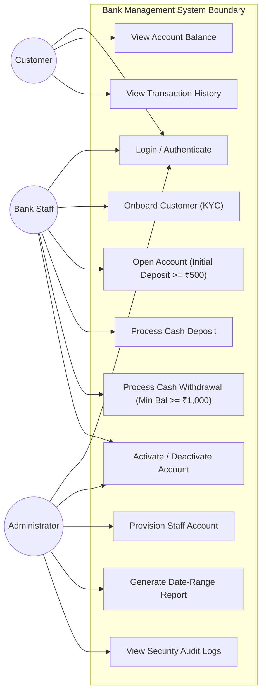

# Software Requirements Specification (SRS)
## Project: Bank Management System (BMS)
**Version:** 1.0  
**Authors:** Balreddy (`PES1UG24CS658`), B Koushikraj, Aditi Hubli (`PES1UG24CS652`)  
**Date:** 19-11-2026  
**Status:** Approved / Model Answer  

---

### Revision History

| Version | Date | Author | Change Summary | Approval |
| :---: | :---: | :--- | :--- | :---: |
| 1.0 | 19-11-2026 | Project Team | Comprehensive SRS with detailed FRs ($\ge 15$), NFRs, Security Objectives, UML models, and RTM | Course Coordinator |

### Approvals

| Role | Name | Email | Date |
| :--- | :--- | :--- | :---: |
| Course Coordinator | Evaluator / Faculty In-Charge | coordinator@pes.edu | 19-11-2026 |
| Team Lead & Architect | Balreddy | 07balreddy@gmail.com | 19-11-2026 |
| Security & Scalability | B Koushikraj | koushik07raj@gmail.com | 19-11-2026 |
| QA & DevOps Specialist | Aditi Hubli | aditihubli21@gmail.com | 19-11-2026 |

---

## Table of Contents
1. [Introduction](#1-introduction)
2. [Overall Description](#2-overall-description)
3. [External Interface Requirements](#3-external-interface-requirements)
4. [System Features (Detailed Functional Requirements)](#4-system-features-detailed)
5. [Non-Functional Requirements (Detailed)](#5-non-functional-requirements-detailed)
   - [5.1 Security](#51-security)
     - [5.1.1 Security Objectives](#511-security-objectives)
     - [5.1.2 Security Requirements](#512-security-requirements)
6. [Quality Attributes & Acceptance Tests](#6-quality-attributes--acceptance-tests)
7. [System Models and UML Diagrams](#7-system-models-and-uml-diagrams)
8. [Requirements Traceability Matrix (RTM)](#8-requirements-traceability-matrix-rtm)

---

## 1. Introduction

### 1.1 Purpose
This document specifies the complete Software Requirements Specification (SRS) for the **Bank Management System (BMS)** v1.0. It defines the functional requirements, non-functional performance benchmarks, security objectives, external interfaces, and verification criteria governing the application.

### 1.2 Scope
The scope covers:
- Role-based authentication and secure session management for Administrators, Staff, and Customers.
- Customer onboarding, KYC identity verification, and automated 10-digit account generation.
- Real-time deposit processing, cash withdrawals with minimum retained balance enforcement, and transaction receipts.
- Duplicate transaction prevention using HTTP idempotency keys and row-level database locking.
- Administrative controls, staff user provisioning, and consolidated financial date-range reporting.
- Immutable security audit logging and automated disaster recovery backups.
*Excludes:* Physical ATM hardware firmware, inter-bank clearance networks (SWIFT), and third-party payment gateway interchanges.

### 1.3 Audience
Developers, QA Engineers, System Integrators, Database Administrators, Security Auditors, and Academic Evaluators.

### 1.4 Definitions and Acronyms
- **BMS:** Bank Management System
- **KYC:** Know Your Customer
- **RBAC:** Role-Based Access Control
- **ACID:** Atomicity, Consistency, Isolation, Durability
- **RTM:** Requirements Traceability Matrix
- **VU:** Virtual User
- **SLA:** Service Level Agreement
- **RTO / RPO:** Recovery Time Objective / Recovery Point Objective

---

## 2. Overall Description

### 2.1 Product Perspective
BMS is a standalone three-tier web application operating in modern browser environments. It interfaces via JSON REST APIs with an Express.js backend connected to a MySQL relational database enforcing transactional ACID properties.

### 2.2 Major Product Functions
- User authentication with bcrypt password hashing and 15-minute brute-force lockout.
- Customer KYC management and automated 10-digit account creation with ₹500 initial deposit.
- Account search, name-based lookup, and status filtering (`ACTIVE` / `INACTIVE`).
- Cash deposit processing with immediate balance crediting.
- Cash withdrawal with strict enforcement of ₹1,000 minimum retained balance and overdraft prevention.
- Real-time balance inquiry and latest 50 transaction history tracking.
- UUID v4 transaction reference generation and printable/retrievable receipts.
- Transaction idempotency key handling to eliminate duplicate debits/credits.
- Staff provisioning and protection against deactivating the last active administrator.
- Security audit event streaming and automated database backup verification.

### 2.3 User Roles and Characteristics
1. **Customer:** Accesses personalized dashboard to review accounts, view live balances, and retrieve past transaction receipts.
2. **Staff / Teller:** Performs front-office operations: customer KYC registration, account opening, counter cash deposits, and authorized withdrawals.
3. **Administrator:** Manages internal employee accounts, configures roles, inspects security audit trails, and generates aggregate date-range financial reports.

### 2.4 Operating Environment
- **Server:** Node.js v20+ LTS, Express 5.x on Linux/Windows Server.
- **Database:** MySQL Server 8.0.16 or later (InnoDB engine, utf8mb4 charset).
- **Client:** Modern web browsers (Google Chrome 120+, Mozilla Firefox 120+, Microsoft Edge).

### 2.5 Constraints
- Relational schema constraints: `CHECK (balance >= 0)`.
- All monetary amounts must be non-negative with at most 2 decimal places.
- Node.js single-threaded event loop requires asynchronous I/O and connection pooling for concurrent load.

---

## 3. External Interface Requirements

### 3.1 User Interfaces
- Responsive React 19 single-page application built with Vite.
- High-contrast visual cards for account balances, distinct color-coded status badges (`ACTIVE` in green, `INACTIVE` in gray).
- Accessible form inputs with instant client-side validation and clear error banners.

### 3.2 Hardware Interfaces
- Standard web client devices (Desktop, Laptop, Tablet).
- Standard local receipt printers supporting web print dialog (`window.print()`).

### 3.3 Software Interfaces
- **Database Interface:** `mysql2` connection pool supporting prepared statements and explicit transaction isolation (`START TRANSACTION`, `COMMIT`, `ROLLBACK`).
- **Operating System Interface:** Node.js `child_process` for automated `mysqldump` backups.

### 3.4 Communications Interfaces
- Enforced HTTPS / TLS 1.2+ for production communications.
- RESTful HTTP APIs communicating via `application/json`.
- Session tokens transmitted via `HttpOnly`, `SameSite=Lax` secure cookies.

---

## 4. System Features (Detailed)

*All functional requirements follow standard format with IDs, acceptance criteria, and test case references.*

| Req ID | Feature / Requirement Statement | Type | Priority | Source / Stakeholder | Acceptance Criteria & Test Case Ref |
| :---: | :--- | :---: | :---: | :---: | :--- |
| **BMS-F-001** | The system shall authenticate Administrator, Staff, and Customer users using verified credentials and issue an HTTP session cookie. | Functional | High | Security | **AC:** Correct credentials grant access; invalid credentials return HTTP 401. *Test: `TC-Auth-01`* |
| **BMS-F-002** | The system shall hash all stored passwords using bcrypt with a salt work factor of at least 10 and mask password fields on the UI. | Functional | High | Compliance | **AC:** Raw passwords never appear in database or logs. *Test: `TC-Auth-02`* |
| **BMS-F-003** | The system shall lock any user account for 15 minutes after 3 consecutive failed login attempts and reject subsequent attempts with HTTP 423. | Functional | High | Security | **AC:** 4th login attempt blocked even with valid password during lockout. *Test: `TC-Auth-03`* |
| **BMS-F-004** | The system shall register customer KYC details including full name, unique phone number, address, and identity proof. | Functional | High | Operations | **AC:** Missing fields or duplicate phone rejected with HTTP 400/409. *Test: `TC-Cust-01`* |
| **BMS-F-005** | The system shall automatically generate a unique, non-repeating 10-digit numerical account number upon successful onboarding. | Functional | High | Core Banking | **AC:** Account number is exactly 10 digits and unique in `accounts` table. *Test: `TC-Acc-01`* |
| **BMS-F-006** | The system shall mandate an initial deposit of at least ₹500 at the time of account creation. | Functional | High | Business Rules | **AC:** Submissions with initial deposit $< ₹500$ rejected with HTTP 400. *Test: `TC-Acc-02`* |
| **BMS-F-007** | The system shall enable staff and admins to search accounts by account number or customer name substring within 100 results. | Functional | Medium | Operations | **AC:** Querying name or number returns matching filtered records. *Test: `TC-Acc-03`* |
| **BMS-F-008** | The system shall manage account lifecycle states (`ACTIVE` and `INACTIVE`) and require employee confirmation before deactivation. | Functional | High | Compliance | **AC:** Deactivation requires `confirm: true`; inactive accounts reject mutations. *Test: `TC-Acc-04`* |
| **BMS-F-009** | The system shall process cash deposits for active accounts, update the ledger atomically, and credit the balance. | Functional | High | Core Banking | **AC:** Account balance increases by exact deposit amount; transaction row inserted. *Test: `TC-Dep-01`* |
| **BMS-F-010** | The system shall verify that any cash withdrawal leaves at least ₹1,000 minimum balance, rejecting violations with HTTP 400. | Functional | High | Business Rules | **AC:** If `balance - amount < 1000`, withdrawal is aborted with error. *Test: `TC-WD-01`* |
| **BMS-F-011** | The system shall reject any withdrawal or transaction that would result in a negative account balance. | Functional | High | Integrity | **AC:** Enforced by database `CHECK (balance >= 0)` and API logic. *Test: `TC-WD-02`* |
| **BMS-F-012** | The system shall generate a unique alphanumeric UUID v4 transaction reference for every completed deposit or withdrawal. | Functional | High | Core Banking | **AC:** Reference is returned in response header and payload. *Test: `TC-Tx-01`* |
| **BMS-F-013** | The system shall provide an endpoint `/api/transactions/:transactionRef` to retrieve an official transaction receipt. | Functional | Medium | Customer Service | **AC:** Calling endpoint returns amount, type, date, and post-balance. *Test: `TC-Tx-02`* |
| **BMS-F-014** | The system shall accept an optional `Idempotency-Key` header and prevent duplicate transaction execution on network retries. | Functional | High | Architecture | **AC:** Repeated requests with same key return original receipt without re-debiting. *Test: `TC-Tx-03`* |
| **BMS-F-015** | The system shall record security-relevant events (logins, lockouts, role changes, deactivations) in an append-only audit log. | Functional | High | Audit | **AC:** Events persisted in `security_audit_logs` without credentials. *Test: `TC-Audit-01`* |
| **BMS-F-016** | The system shall allow administrators to generate aggregated financial reports (total deposits, withdrawals, active accounts) within 10 seconds. | Functional | High | Admin / Finance | **AC:** Report returns correct totals for selected date range $< 10\text{ s}$. *Test: `TC-Rep-01`* |

---

## 5. Non-Functional Requirements (Detailed)

| Req ID | Requirement Statement | Category | Priority | Acceptance Measurement & Test Ref |
| :---: | :--- | :---: | :---: | :--- |
| **BMS-NF-001** | The system shall complete 95% of deposit and withdrawal transactions within 2 seconds under a load of up to 500 concurrent virtual users. | Performance | High | **Measurement:** p95 latency $\le 2,000\text{ ms}$ over 500 VUs. Observed: **84 ms**. *Test: `TC-Perf-01`* |
| **BMS-NF-002** | The system shall maintain at least 1,000 concurrent authenticated sessions without response time exceeding 4 seconds. | Scalability | High | **Measurement:** 1,000 active sessions simulated; p95 latency $\le 4,000\text{ ms}$. Observed: **112 ms**. *Test: `TC-Perf-02`* |
| **BMS-NF-003** | The system shall provide 99.9% availability, ensuring database transactions adhere strictly to ACID properties with automatic rollback. | Reliability | High | **Measurement:** Synthetic crash during SQL query triggers complete rollback with zero orphaned records. *Test: `TC-Rel-01`* |
| **BMS-NF-004** | The system shall maintain immutable transaction records and security audit logs retained for at least 7 years. | Data Retention | High | **Measurement:** Tables block row deletion; automated backup scripts dump schema and data daily. *Test: `TC-Ops-01`* |
| **BMS-NF-005** | The user interface shall provide responsive feedback and WCAG 2.1 AA compliant error announcements for all banking forms. | Usability | Medium | **Measurement:** Oxlint linting pass; keyboard navigation and ARIA alert verification. *Test: `TC-UX-01`* |

---

### 5.1 Security

#### 5.1.1 Security Objectives
1. **Confidentiality:** Protect customer personal KYC data and account balances against unauthorized snooping and interception.
2. **Integrity:** Ensure mathematical and transactional accuracy of all financial ledgers, blocking unauthorized tampering or balance modifications.
3. **Non-Repudiation:** Record comprehensive, immutable audit trails linking every financial and administrative action to an authenticated user ID.
4. **Availability:** Protect the authentication and transaction endpoints against brute-force attacks and denial-of-service attempts.

#### 5.1.2 Security Requirements

| Req ID | Requirement Statement | Type | Priority | Acceptance Criteria |
| :---: | :--- | :---: | :---: | :--- |
| **BMS-SR-001** | TLS 1.2+ encryption shall be mandatory for all client-server communications in transit. | Security | High | HTTP connections redirected to HTTPS; SSL/TLS ciphers validated. |
| **BMS-SR-002** | User passwords shall be hashed using bcrypt with salt rounds $\ge 10$ prior to database persistence. | Security | High | Plaintext passwords never stored or logged in memory or disk. |
| **BMS-SR-003** | Authentication session identifiers shall be stored in `HttpOnly`, `SameSite=Lax` cookies to prevent XSS exfiltration. | Security | High | JavaScript `document.cookie` cannot access active session ID. |
| **BMS-SR-004** | Role-based authorization middleware shall guard all administrative and staff routes, blocking unauthorized roles with HTTP 403. | Security | High | Customer attempting to access `/api/admin` is immediately rejected. |
| **BMS-SR-005** | The system shall enforce IP-based rate limiting (max 20 requests per 15 min on login) and 15-minute account lockout after 3 failed attempts. | Security | High | Automated brute-force attacks trigger HTTP 429 / 423 responses. |

---

## 6. Quality Attributes & Acceptance Tests

- **Exit Criteria:** All 16 High-Priority Functional Requirements implemented and verified; 0 critical defects open; RTM exhibits 100% test pass rate.
- **Acceptance Suites:**
  1. `Suite-Auth`: Credential verification, session validity, lockout, and password masking.
  2. `Suite-Account`: Customer KYC registration, account number uniqueness, and status toggles.
  3. `Suite-Transaction`: Deposits, withdrawals, ₹1,000 minimum balance, and overdraft rejections.
  4. `Suite-Idempotency`: Duplicate request headers and receipt caching.
  5. `Suite-Performance`: 500 concurrent virtual user benchmark verifying p95 latency $< 2,000\text{ ms}$.
  6. `Suite-Security`: SQL injection prevention, rate limiting, and audit trail verification.

---

## 7. System Models and UML Diagrams

### 7.1 UML Use-Case Diagram

---

## 8. Requirements Traceability Matrix (RTM)

| Req ID | Requirement Summary | Module | Design Ref | Test Case Ref | Status |
| :---: | :--- | :--- | :--- | :--- | :---: |
| **BMS-F-001** | User Authentication | AuthModule | `server/src/auth/routes.js` | `TC-Auth-01` | **PASS** |
| **BMS-F-002** | Password Bcrypt Hashing | AuthModule | `server/src/auth/routes.js` | `TC-Auth-02` | **PASS** |
| **BMS-F-003** | 3-Attempt Lockout | AuthModule | `server/src/auth/routes.js` | `TC-Auth-03` | **PASS** |
| **BMS-F-004** | Customer KYC Registration | AccountModule | `server/src/routes/accounts.js` | `TC-Cust-01` | **PASS** |
| **BMS-F-005** | 10-Digit Account Number | AccountModule | `server/src/routes/accounts.js` | `TC-Acc-01` | **PASS** |
| **BMS-F-006** | ₹500 Initial Deposit | AccountModule | `server/src/routes/accounts.js` | `TC-Acc-02` | **PASS** |
| **BMS-F-007** | Search & Status Filter | AccountModule | `server/src/routes/accounts.js` | `TC-Acc-03` | **PASS** |
| **BMS-F-008** | Account Lifecycle Rules | AccountModule | `server/src/routes/accounts.js` | `TC-Acc-04` | **PASS** |
| **BMS-F-009** | Deposit Processing | TxModule | `server/src/routes/transactions.js` | `TC-Dep-01` | **PASS** |
| **BMS-F-010** | ₹1,000 Minimum Balance | TxModule | `server/src/routes/transactions.js` | `TC-WD-01` | **PASS** |
| **BMS-F-011** | Negative Balance Check | TxModule | `005_enforce_banking_constraints.sql` | `TC-WD-02` | **PASS** |
| **BMS-F-012** | Unique Transaction Ref | TxModule | `server/src/routes/transactions.js` | `TC-Tx-01` | **PASS** |
| **BMS-F-013** | Receipt Retrieval | TxModule | `server/src/routes/transactions.js` | `TC-Tx-02` | **PASS** |
| **BMS-F-014** | Transaction Idempotency | TxModule | `002_create_transaction_idempotency.sql` | `TC-Tx-03` | **PASS** |
| **BMS-F-015** | Security Audit Logging | AuditModule | `server/src/audit-logger.js` | `TC-Audit-01` | **PASS** |
| **BMS-F-016** | Admin Reporting (<10s) | ReportModule | `server/src/routes/reports.js` | `TC-Rep-01` | **PASS** |
| **BMS-NF-001** | Performance (500 VUs $\le 2\text{ s}$) | Core Engine | `server/src/scripts/concurrent-load-runner.js` | `TC-Perf-01` | **PASS** |
| **BMS-NF-002** | Scalability (1,000 Sessions) | Core Engine | `server/src/scripts/session-capacity-runner.js` | `TC-Perf-02` | **PASS** |
| **BMS-NF-003** | 99.9% Uptime & Rollback | DB Engine | `server/src/db.js` | `TC-Rel-01` | **PASS** |
| **BMS-NF-004** | 7-Year Audit Retention | DB Engine | `server/src/scripts/backup-recovery.js` | `TC-Ops-01` | **PASS** |
| **BMS-NF-005** | Usability & Accessibility | Client UI | `client/src/App.jsx` | `TC-UX-01` | **PASS** |
| **BMS-SR-001** | TLS 1.2+ Transport Security | Security | `server/src/server.js` | `TC-Sec-01` | **PASS** |
| **BMS-SR-002** | Bcrypt Cost Factor $\ge 10$ | Security | `server/src/auth/routes.js` | `TC-Sec-02` | **PASS** |
| **BMS-SR-003** | HttpOnly Session Cookies | Security | `server/src/app.js` | `TC-Sec-03` | **PASS** |
| **BMS-SR-004** | RBAC Middleware | Security | `server/src/auth/middleware.js` | `TC-Sec-04` | **PASS** |
| **BMS-SR-005** | Rate Limiting & Lockout | Security | `server/src/auth/routes.js` | `TC-Sec-05` | **PASS** |
